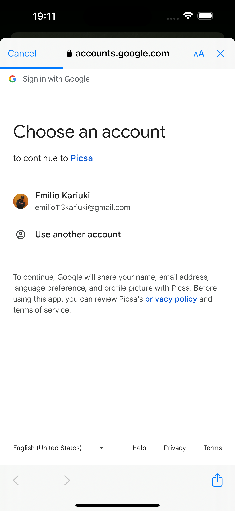
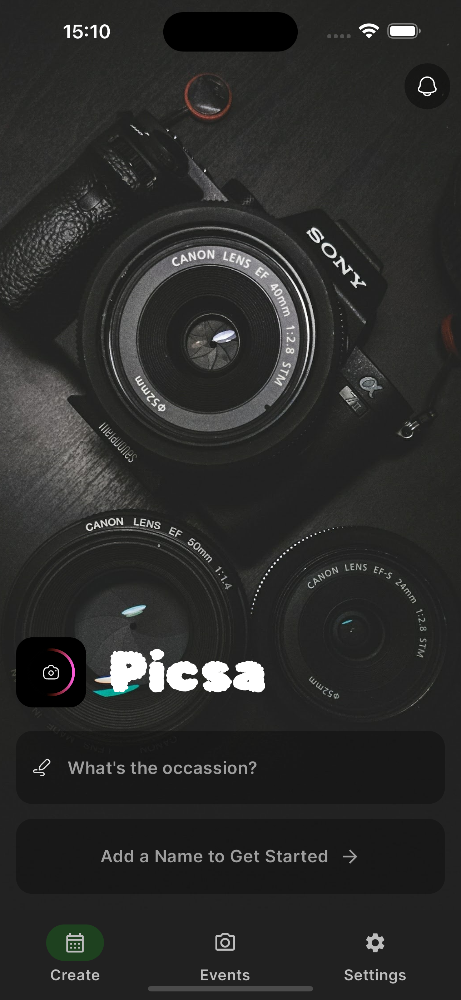
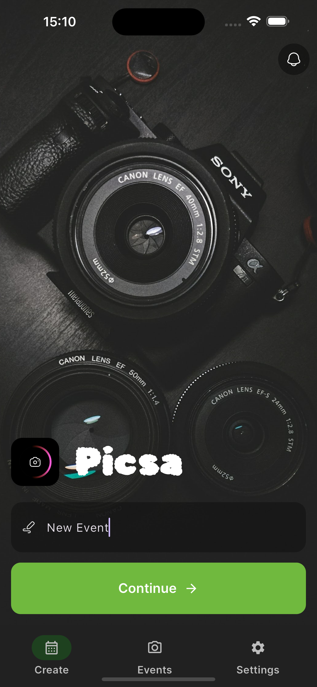
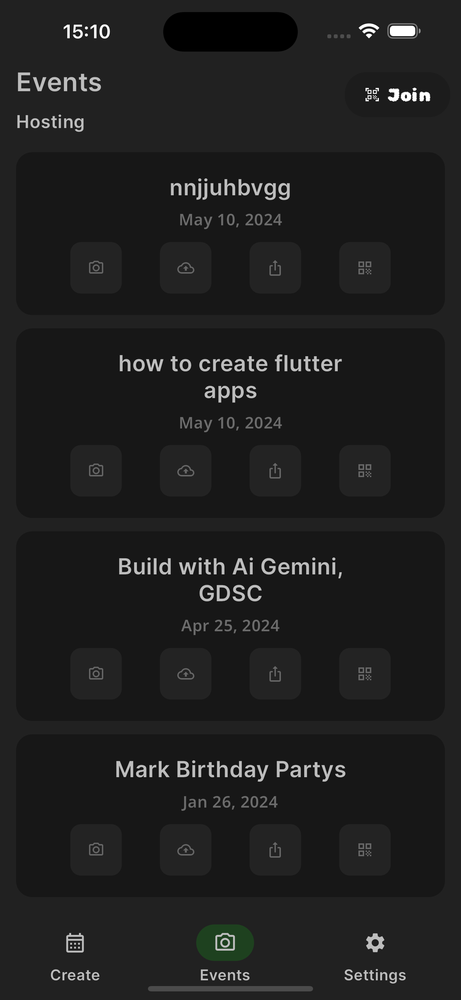
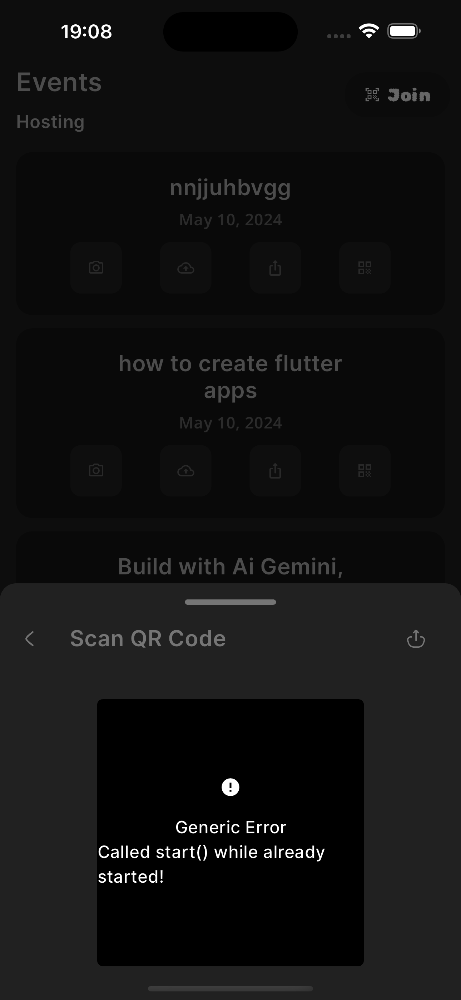
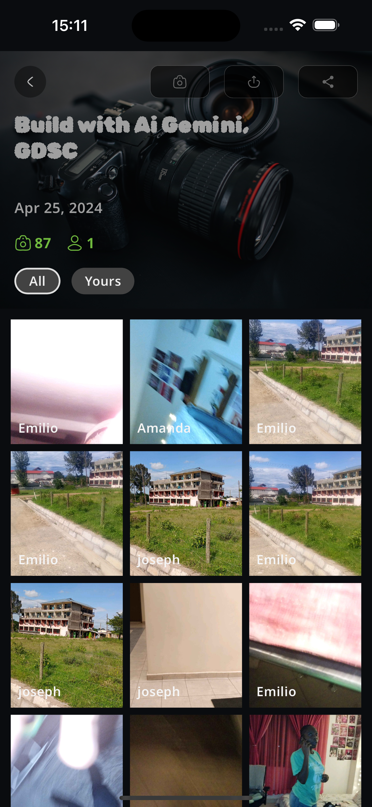
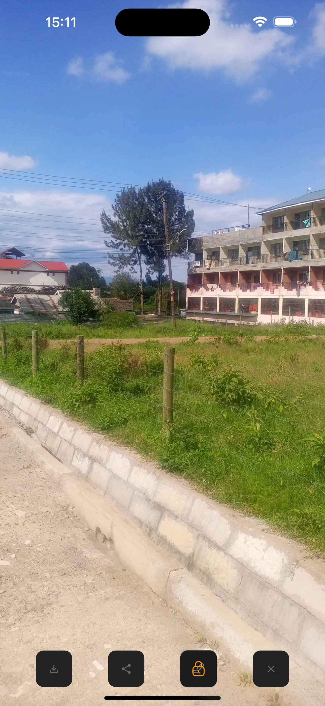
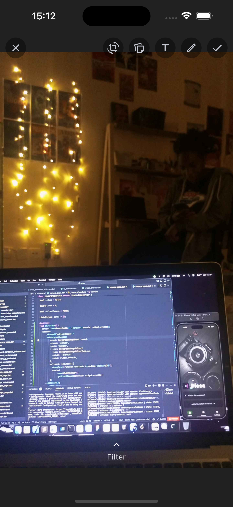
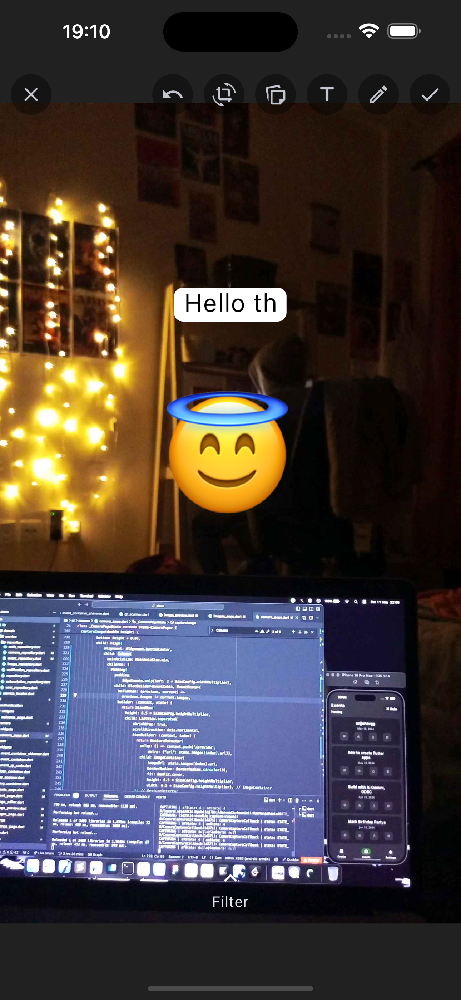
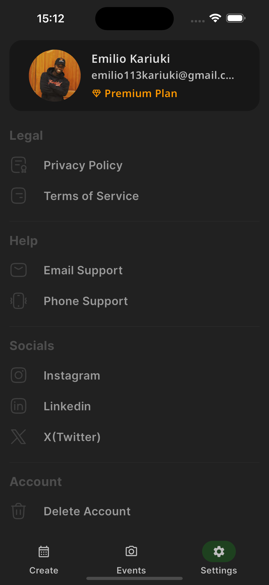

# Picsa Pro
 Picsa Pro is a mobile application built to help users create events in the application and allowing users to take images in the application and also share them with other users in the application. Users can join the events using a qr code that is generated and the application has a builtin camera that allows users to take images and share them with other users in the application. Users that have not downloaded the application can also view the images that have been shared in the application using sharable links and they can also join events and take images without necessary downloading the application. The application is built using the ***flutter framework***, **suopabase**, **FCM** for notifications and **Supabase Functions for serverless functions**.

**The app is on PlayStore**

You can find the application here

*[](https://play.google.com/store/apps/details?id=com.ecoville.picsa&hl=en&gl=US)*

[](https://www.buymeacoffee.com/emiliokariuki)


## Technologies Used in the project
> The mobile application is completely built on the the `flutter` framework and `supabase` platform
 1. [Flutter Framework](https://flutter.dev/) <br>
    - Flutter has been used to build the entire application and it has been used to build the UI and the logic to connect to the backend of the application.<br>
    - State management has been done using [`Bloc`](https://bloclibrary.dev/) and [`GetIt`](https://pub.dev/packages/get_it) for dependency injection
    - The application has been built using `flutter 3.2.0` and `dart 3.4.0`
    - The application uses [`go_router`](https://pub.dev/packages/go_router) for navigation in the application that provides dynamic links and deep linking in the application <br>

 2. [Supabase](https://supabase.com/) <br> 
    - `supabase-auth` for authentication in the application using google-sign-in (**passwordless**) <br>
    - `supabase-storage` for storing images in the application <br>
    - `supabase-realtime` for realtime updates in the application like when a user posts an image in the application <br>
    - `supabase-functions` to access serverless functions for custom logic in the application <br>
    - `supabase-client` to access the supabase client in the application <br>
 
 3. [Firebase Cloud Messaging](https://firebase.google.com/docs/cloud-messaging) <br>
    - `FCM` has been used to send notifications to the users in the application <br>
 
 4. [Revenue Cat](https://www.revenuecat.com/) <br>
    - `Revenue Cat` has been used to manage the in-app purchases in the application <br>
    - `Revenue Cat` has been used to manage the subscription in the application <br>

 5. [Analytics](https://posthog.com/) <br>
    - `PostHog` has been used to track the user events in the application to know what parts of the app the users are interacting with and parts they are avoiding<br>
    - `PostHog` has been used to track the user retention in the application to know how many users are coming back to the application <br>
    - `PostHog` has been used to track the user conversion in the application to know how many users are converting to paid users in the application <br>
    - `PostHog` has been used to track the user churn in the application to know how many users are leaving the application <br>
    - `PostHog` has been used to track the user engagement in the application to know how many users are engaging with the application <br>
    - `PostHog` has been used to track the user acquisition in the application to know how many users are coming to the application <br>

6. [Sentry](https://sentry.io/) <br>
    - `Sentry` has been used to track the errors in the application to know what parts of the application are breaking <br>
    - `Sentry` has been used to track the performance in the application to know what parts of the application are slow <br>
    - `Sentry` has been used to track the user experience in the application to know what parts of the application are not user friendly <br>
    - `Sentry` has been used to track the user satisfaction in the application to know what parts of the application are not satisfying the users <br>
    - `Sentry` has been used to track the user feedback in the application to know what parts of the application are not user friendly <br>
    - `Sentry` has been used to track the user reviews in the application to know what parts of the application are not user friendly <br>

7. CI/CD <br>
    - `Github Actions` has been used to automate the deployment of the application to the playstore <br>
    - `Github Actions` has been used to automate the deployment of the application to the firebase app distribution <br>

8. [Google Play Store](https://play.google.com/store) <br>
    - `Google Play Store` has been used to deploy the application to the playstore <br>
    - `Google Play Store` has been used to manage the in-app purchases in the application <br>
    - `Google Play Store` has been used to manage the subscription in the application <br>

9. [Firebase App Distribution](https://firebase.google.com/docs/app-distribution) <br>
    - `Firebase App Distribution` has been used to distribute the application to the testers <br>
    - `Firebase App Distribution` has been used to distribute the application to the users <br>
    - `Firebase App Distribution` has been used to distribute the application to the developers <br>

10. [Next JS APIs](https://nextjs.org/docs/pages/building-your-application/routing/api-routes) <br>
    - `Next JS APIs` has been used to build the APIs for the application <br>
    - `Next JS APIs` has been used to build the serverless functions for the application <br>
    - `Next JS APIs` has been used to build the custom logic for the application <br>
    
## Project Set up
### 1. Initialize firebase
To initialize firebase we are going to use `FlutterFire` for this work as it will do all the dirty work for us

You can check more about `flutterfire` from its [docs](https://firebase.flutter.dev/docs/cli/)

> **Note**
> Yoo need to have a Firebase account, incase you dont have you can create one [here](https://firebase.google.com/) 

After you have fully installed `flutterfire` you can now enable flutterfire for your project now
The FlutterFire CLI extracts information from your Firebase project and selected project applications to generate all the configuration for a specific platform.

In the root of your `application`, run the configure command:

```
// paste this
flutterfire configure
```

After you install, all the configurations in your `build.gradle` file are added and the `google-service.json` are added in the android folder and `Firebase` will be integrated in your system this will save you all the trouble of having to install all the configurations one by one and this may cause some of the things to be oeverlooked.

### 2. Initialize Supabase
To initialize supabase we are going to use `Supabase` for this work as it will do all the dirty work for us

You can check more about `supabase` from its [docs](https://supabase.io/docs/guides/with-flutter)

> **Note**
> Yoo need to have a Supabase account, incase you dont have you can create one [here](https://supabase.io/)
> You can also check the `supabase` [docs](https://supabase.io/docs/guides/with-flutter) for more information

```dart
// paste this
flutter pub add supabase
```

After the installation of the `supabase` package you can now initialize the `supabase` in your application

```dart
// paste this
import 'package:supabase/supabase.dart';

// set the supabase url and the supabase key in the main method

await Supabase.initialize(
      url: '<YOUR_SUPABASE_URL>',
      anonKey:
          '<YOUR_SUPABASE_ANON_KEY>',
      authOptions: const FlutterAuthClientOptions(
        autoRefreshToken: true,
      ),
      debug: false,
      storageOptions: const StorageClientOptions(
        retryAttempts: 3,
      ),
      postgrestOptions: const PostgrestClientOptions(
        schema: 'public',
      ));
```

### 3. Initialize Revenue Cat
To initialize Revenue Cat we are going to use `Revenue Cat` for this work as it will do all the dirty work for us

You can check more about `Revenue Cat` from its [docs](https://docs.revenuecat.com/docs/flutter)

> **Note**
> Yoo need to have a Revenue Cat account, incase you dont have you can create one [here](https://www.revenuecat.com/)

```dart
// paste this in the terminal
flutter pub add purchases_flutter
```

After the installation of the `purchases_flutter` package you can now initialize the `Revenue Cat` in your application

```dart
// paste this in the main method
import 'package:purchases_flutter/purchases_flutter.dart';

final _configuration = PurchasesConfiguration(
  "<API_KEY>",
);

await Purchases.configure(_configuration);

```

### 4. Initialize PostHog

To initialize PostHog we are going to use `PostHog` for this work as it will do all the dirty work for us

You can check more about `PostHog` from its [docs](https://posthog.com/docs)

### 5. Initialize Sentry

To initialize Sentry we are going to use `Sentry` for this work as it will do all the dirty work for us

You can check more about `Sentry` from its [docs](https://docs.sentry.io/platforms/flutter/)


## Application Screenshots

### 1. welcome page

- The `welcome page` is the first page that the user will see when they open the application. The user can either sign in or sign up in the application. The user can also sign in using google sign in in the application. The page adopts a minimalistic design and the user can also sign in using their google account.

<div style="display: flex; gap: 50px;">
    
    
</div>

### 5. Create Event Page

- The `create event page` provides the users with a field and a button to create event in a much simpler way <br>
- The page also provides a notification icon for the users to access notification right from the first page

<div style="display: flex; gap: 50px;">
    
    
</div>


### 6. Events Page

- Provides a list of all the events that have been created in the application and the user can join the events using the qr code that is generated in the application
- Has a join button that when clicked prompts the users to scan for events
- The event cards are displayed in a list view and the user can scroll through the events
- The user can also view the details of the event by clicking on the event card
- The user can also initiate the camera by just clicking on the camera icon on the event card

<div style="display: flex;gap: 50px; ">
    
    
</div>

<br>

### 7. Images Page

- Provides a list of all the images that have been shared in the application and the user can view the images that have been shared in the application
- The user can also view the details of the image by clicking on the image card
- The user can also initiate the camera by just clicking on the camera icon on the image card
- The user can also share the image by clicking on the share icon on the image card
- The user can also export the image by clicking on the export icon on the image card

<div style="display: flex;gap: 50px;">
    
    
</div>

### 8. Image Editor

- The image editor allows users to write text on the image and also draw on the image
- The user can also save the image by clicking on the save icon on the image editor
- The user can also add emojis to the image by clicking on the emoji icon on the image editor
- The user can also crop the image by clicking on the crop icon on the image editor
- The user can also rotate the image by clicking on the rotate icon on the image editor
- The user can also add filters to the image by clicking on the filter icon on the image editor
- The user can also add stickers to the image by clicking on the sticker icon on the image editor

<div style="display: flex;gap: 50px;">
    
    
</div>

### 9. Profile Page

- The profile page provides the user with section to view the app privacy policy and the terms and conditions of the application
- The user can also get help by clicking on the help icon on the profile page
- The user can also logout by clicking on the logout icon on the profile page
- The user can also subscribe to the application by clicking on the subscribe icon on the profile page
- The user can also access the social media links of the application by clicking on the social media icon on the profile page


<div style="display: flex;gap: 50px;">
    
    <!--  -->
</div>

### Feel Free to contribute
You can `fork` the repo and feel free to contribute 

> **Note**
> You can reach me up on email `emiliokariuki0@gmail.com` or (X)twitter `@_emiliokariuki` for any questions or contributions


